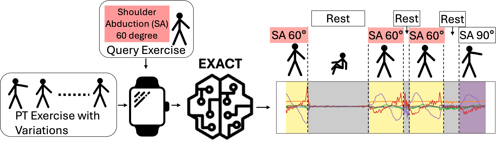

[](https://doi.org/10.5281/zenodo.14834927)

[EXACT Paper (ICCPS-2025)](http://doi.org/10.1145/3716550.3722027)

# EXACT: A Meta-Learning Framework for Precise Exercise Segmentation in Physical Therapy

**Corresponding Author:** Hanchen David Wang

## Citation

If you use this work, please cite our paper:

```bibtex
@inproceedings{wang2025exact,
  title={EXACT: A Meta-Learning Framework for Precise Exercise Segmentation in Physical Therapy},
  author={Wang, Hanchen David and Bae, Siwoo and Sun, Xutong and Thatigotla, Yashvitha and Ma, Meiyi},
  booktitle={Proceedings of the ACM/IEEE 16th International Conference on Cyber-Physical Systems (with CPS-IoT Week 2025)},
  pages={1--11},
  year={2025}
}
```

This repository provides an implementation for meta-learning on dense labeling tasks using various deep learning models. The project includes customizable support for models and datasets, with augmentation, training, and evaluation configurations. It leverages the WandB logging framework for experiment tracking.





## Table of Contents
- [Installation](#installation)
- [Usage](#usage)
- [Arguments](#arguments)
- [Supported Models](#supported-models)
- [Supported Datasets](#supported-datasets)
- [Example Commands](#example-commands)
<!-- - [License](#license) -->

## Installation

1. Clone this repository:
    ```bash
    git clone https://github.com/HCWDavid/EXACT-TCPS.git
    cd EXACT-TCPS
    ```
2. Install dependencies:
    ```bash
    pip install -r requirements.txt
    ```
3. Install WandB for experiment tracking (optional):
    ```bash
    pip install wandb
    ```

## Usage

To train a model, use:
```bash
python main.py --dataset <dataset_name> --model <model_name> --data_root <path_to_data>
```

Example:
```bash
python main.py --dataset physiq --model unet --data_root ./data
```

## Arguments

### Main Parameters

- `--data_root`: Root directory for the dataset.
- `--dataset`: Dataset to use for training (`physiq`, `spar`, `mmfit`).
- `--model`: Model to use for training (`unet`, `transformer`, `ex`, `segmenter`, `cnn`).

### Dataset-Specific Parameters

- `--window_size`: Window size for sliding window (default: 500).
- `--window_step`: Step size for sliding window (default: 25).
- `--rotation_chance`: Probability of applying random rotation to data (default: 0).

### Training Parameters

- `--lr`: Learning rate for the meta-optimizer (default: 1e-3).
- `--meta_lr`: Learning rate for the inner optimizer (default: 1e-2).
- `--n_inner_iter`: Number of inner-loop iterations (default: 1).
- `--n_epochs`: Number of training epochs (default: 30).
- `--device`: Device to use for training (default: "cuda").

### WandB Logging

- `--wandb_project`: Name of the WandB project for logging experiments.
- `--nowandb`: Disable WandB logging.

### Cross-Validation

- `--loocv`: Enable Leave-One-Out Cross-Validation.

For a complete list of options, please refer to the `get_args` function in the main script.

## Supported Models

- **UNet**: Designed for dense labeling with encoder-decoder architecture.
- **Transformer**: Transformer model adapted for dense labeling tasks.
- **EX (EXACT)**: Custom model for dense labeling.
- **Segmenter**: A model for segmentation tasks.
- **CNN**: Simple Convolutional Neural Network for dense labeling tasks.

## Supported Datasets
Please go to data folder to download the datasets.
<!-- a hyperlink to that readme -->
- **[dataset README](./data/README.md)**

- **PhysiQ**: Dataset with IMU data used for exercise and physical activity monitoring.
- **SPAR**: Another IMU-based dataset.
- **MMFIT**: Dataset for physical fitness with dense labeling tasks.

## Example Commands

Training a UNet on the PhysiQ dataset:
```bash
python main.py --dataset physiq --model unet --window_size 500 --window_step 25 --n_epochs 30 --lr 1e-3
```

Using WandB logging:
```bash
python main.py --dataset spar --model transformer --wandb_project EXACT
```

Leave-One-Out Cross-Validation:
```bash
python main.py --dataset mmfit --model segmenter --loocv
```

## What is new in the TCPS journal version

The journal model is `--model caex` (`methods/CAEX.py`, class `CAEX`, built on the ICCPS model `EX` in
`methods/EX.py`). Everything added for the journal article lives in these files:

| Component | Where | Flag (default on) |
|---|---|---|
| On-the-fly IMU normalization (per-window z-score, rest samples excluded from the statistics) | `datasets/Transforms.py` (`IMUNormalizer`), wired in `methods/CAEX.py` | `--caex_imu_normalize` |
| Orientation augmentation (random 3-D rotation of acc and gyro) | `datasets/Transforms.py` (`RotationAugmentation`) | `--caex_rotation_chance` |
| Channel SE-gate (per-channel attention over the 6 IMU channels) | `methods/CAEX.py` (`ChannelSEGate`) | `--caex_gate se` / `none` |
| Acc/gyro group gate | `methods/CAEX.py` (`AccGyroGroupGate`) | `--caex_group_gate` |
| AdaBN (batch-norm statistics re-estimated on the support set at meta-test) | `methods/adabn.py` (`AdaBNWrapper`) | `--caex_use_adabn` |
| Meta-task sampler (one exercise, 1..k queried variations per task, dense labels) | `datasets/DenseLabelTaskSampler.py` | `--n_shot --n_query` |
| Synthetic rest intervals between recordings | `datasets/QueryDataset.py` (`generate_noise`) | `--add_side_noise --noise_type all` |
| Real-time / streaming benchmark (latency, memory, MACs, MAML adaptation latency) | `eval_realtime.py`, `run_all_realtime_eval.sh` | |
| Out-of-distribution evaluation PhysiQ -> PhyTMo, zero-shot and few-shot | `eval_phytmo_ood.py`, `datasets/PHYTMO.py` | `--n_inner_iter 0 --no_adabn` for zero-shot |
| On-device latency (Core ML export, iOS/watchOS benchmark app, results) | `experiments/edge/` (see its README) | |

The complete pipeline that produced every table of the article (job lists, aggregation, LaTeX table
generator, raw results, checkpoints) is documented in `experiments/README.md`; `results/runs/*.json`,
`results/ood/`, `results/edge/` and `saved_model/` hold the raw numbers and the trained weights.
Data splits: standard training splits each (subject, exercise, variation) group of recordings 80/20
into train/test by recording (`--dataset_seed 42`); leave-one-subject-out uses the subject folds in
`until_argparser.get_all_subjects` (`--loocv`); see the appendix of the article for the protocol.

## Docker Usage

This section explains how to use **EXACT** via a Docker container. You can either **build the Docker image** yourself or **pull a prebuilt image** from Docker Hub.

### 1. Pull the Docker Image
If you just want to run EXACT without building from source, pull the image from Docker Hub:
```bash
docker pull wang584041187/exact:latest
```
  
- **On a machine with NVIDIA GPU (for CUDA)**:
  ```bash
  docker run -it --rm --gpus all wang584041187/exact:latest
  ```
- **On a Mac M1/M2/M3 (ARM64)**:
  ```bash
  docker run -it --rm --platform=linux/arm64 wang584041187/exact:latest
  ```
- **On a CPU-only machine**:
  ```bash
  docker run -it --rm wang584041187/exact:latest
  ```

Once inside the container, you can run any of the commands you normally would in your local environment (e.g., `python main.py ...`).

---

### 2. (Optional) Build the Docker Image Locally
If you’d prefer to build the Docker image using your latest code changes, do the following in the project directory:
```bash
docker build -t exact .
```
  
Then, you can run:
```bash
docker run -it --rm --gpus all exact
```
(Adjust `--gpus all` or `--platform=linux/arm64` as needed.)

---

### 3. If You Do NOT Have W&B (Weights & Biases)
If you **don’t** want to use **WandB** or don’t have an account, remove or comment out the relevant lines in any scripts (e.g., `train.sh`, `main.py`) that call `wandb`:
```bash
# wandb.init(project="EXACT")
# wandb.log({...})
```
Or, when running your Python scripts, you can pass the `--nowandb` argument to disable WandB logging:
```bash
python main.py --dataset physiq --model unet --nowandb
```
This prevents WandB from initializing or tracking metrics.

---

### 4. Running the Training Script Inside Docker
If you have a dedicated `.sh` script (e.g., `scripts/train.sh`):

1. **Run** the script:
   ```bash
   bash run_normal.sh 
   ```
   or 
   ```bash
   bash run_loocv.sh 
   ```
   or if you want to check results only:
   ```bash
    bash repeat.sh 
    ```

3. If you **removed** WandB lines or used `--nowandb`, ensure the script does not call `wandb`.

---

### 5. Exiting the Container
When you’re finished, type:
```bash
exit
```
to stop the container. If you used `--rm`, the container is automatically removed.

---

### 6. Additional Notes
- **CUDA**: To verify CUDA is working, run:
  ```bash
  python -c "import torch; print(torch.cuda.is_available())"
  ```
  If it prints `True`, CUDA is enabled.
- **Modifying Scripts**: If your `.sh` scripts were created on Windows, convert line endings to Unix (e.g., using `dos2unix`) to avoid the `^M` interpreter error.
- **Updating the Image**: If you change code in this repo and want an updated Docker image, rebuild or push a new version to Docker Hub.

With Docker, you can now replicate the environment quickly on any system—GPU or CPU—without worrying about local dependencies.
